# 非対称鍵暗号 概念モデル

公開鍵暗号に関わるアルゴリズム、鍵ペア、鍵形式の分類と関係性を定義する。

## 概要

非対称鍵暗号は、暗号化と復号に異なる鍵（公開鍵・秘密鍵）を使用する暗号方式。このモデルでは以下を定義する:

| カテゴリ | 内容 |
|---------|------|
| 鍵ペア | RSA、EC、DSA、DH、ポスト量子鍵 |
| 従来型アルゴリズム | RSA、DSA、DH、ECDSA、ECDH、EdDSA、Schnorr |
| ポスト量子アルゴリズム | ML-KEM、ML-DSA、SLH-DSA、FrodoKEM、NTRU、McEliece |
| 楕円曲線 | P-256/384/521、Curve25519/448、secp256k1 |
| 機能分類 | Encryption、DigitalSignature、KeyExchange、KeyEncapsulation |
| ハイブリッド暗号 | KEM（RSA-KEM、ECIES、HPKE）+ DEM |
| RSAスキーム | OAEP、PSS、PKCS#1 v1.5 |
| 鍵形式 | PKCS#1、PKCS#8、SPKI、JWK、OpenSSH |

## 関連ドキュメント

- `symmetric-crypto-concepts.md` : AEAD、KDF、ハッシュ関数（ハイブリッド暗号のDEM部分）
- `crypto-operations.md` : 暗号化/署名/鍵交換/KEMの操作インターフェース
- `crypto-variants.md` : 各アルゴリズムの具体的パラメータ、鍵/署名サイズ
- `cli-reference.md` : OpenSSL/GPGコマンド

## クラス図

```mermaid
classDiagram
    direction TB

    %% ========== 鍵ペア ==========
    class KeyPair {
        <<abstract>>
    }
    class PublicKey {
        <<abstract>>
        公開可能
    }
    class PrivateKey {
        <<abstract>>
        秘匿必須
    }

    KeyPair *-- PublicKey : contains
    KeyPair *-- PrivateKey : contains

    %% RSA鍵
    class RSAKeyPair {
        鍵長: 2048/3072/4096 bits
    }
    class RSAPublicKey {
        n: modulus
        e: public exponent
    }
    class RSAPrivateKey {
        n, d, p, q, dp, dq, qinv
        CRT形式
    }

    KeyPair <|-- RSAKeyPair : is-a
    PublicKey <|-- RSAPublicKey : is-a
    PrivateKey <|-- RSAPrivateKey : is-a
    RSAKeyPair *-- RSAPublicKey : contains
    RSAKeyPair *-- RSAPrivateKey : contains

    %% EC鍵
    class ECKeyPair {
        曲線パラメータ
    }
    class ECPublicKey {
        Q: 曲線上の点 (x, y)
    }
    class ECPrivateKey {
        d: スカラー値
    }

    KeyPair <|-- ECKeyPair : is-a
    PublicKey <|-- ECPublicKey : is-a
    PrivateKey <|-- ECPrivateKey : is-a
    ECKeyPair *-- ECPublicKey : contains
    ECKeyPair *-- ECPrivateKey : contains
    ECKeyPair --> EllipticCurve : bound to

    %% DSA鍵
    class DSAKeyPair {
        鍵長: 2048/3072 bits
    }
    class DSAPublicKey {
        p, q, g: 群パラメータ
        y: 公開値
    }
    class DSAPrivateKey {
        x: 秘密スカラー
    }

    KeyPair <|-- DSAKeyPair : is-a
    PublicKey <|-- DSAPublicKey : is-a
    PrivateKey <|-- DSAPrivateKey : is-a
    DSAKeyPair *-- DSAPublicKey : contains
    DSAKeyPair *-- DSAPrivateKey : contains

    %% DH鍵
    class DHKeyPair {
        群パラメータ
    }
    class DHPublicKey {
        p, g: 群パラメータ
        y: 公開値
    }
    class DHPrivateKey {
        x: 秘密スカラー
    }

    KeyPair <|-- DHKeyPair : is-a
    PublicKey <|-- DHPublicKey : is-a
    PrivateKey <|-- DHPrivateKey : is-a
    DHKeyPair *-- DHPublicKey : contains
    DHKeyPair *-- DHPrivateKey : contains

    %% ========== アルゴリズムの分類 ==========
    class AsymmetricAlgorithm {
        <<abstract>>
    }

    class RSA {
        鍵長: 2048/3072/4096 bits
        暗号化・署名・鍵交換
    }
    class DSA {
        鍵長: 2048/3072 bits
        署名のみ
        非推奨 (FIPS 186-5)
    }
    class DH {
        Diffie-Hellman
        鍵交換のみ
    }
    class ECC {
        <<abstract>>
        楕円曲線暗号
    }

    AsymmetricAlgorithm <|-- RSA : is-a
    AsymmetricAlgorithm <|-- DSA : is-a
    AsymmetricAlgorithm <|-- DH : is-a
    AsymmetricAlgorithm <|-- ECC : is-a
    AsymmetricAlgorithm <|-- ElGamal : is-a

    class ElGamal {
        暗号化・署名
        離散対数問題
    }

    %% ========== 楕円曲線の種類 ==========
    class ECDSA { 署名 }
    class ECDH {
        <<abstract>>
        鍵交換
    }
    class EdDSA {
        <<abstract>>
        署名
    }

    ECC <|-- ECDSA : is-a
    ECC <|-- ECDH : is-a
    ECC <|-- EdDSA : is-a
    ECC <|-- Schnorr : is-a

    %% EdDSAの具体的バリアント
    class Ed25519 {
        Curve25519ベース
        署名: 64 bytes
        公開鍵: 32 bytes
    }
    class Ed448 {
        Curve448ベース
        署名: 114 bytes
        公開鍵: 57 bytes
        高セキュリティ (224-bit)
    }

    EdDSA <|-- Ed25519 : is-a
    EdDSA <|-- Ed448 : is-a

    Ed25519 --> Curve25519 : uses
    Ed448 --> Curve448 : uses

    %% ECDHの具体的バリアント
    class X25519 {
        Curve25519ベース
        共有秘密: 32 bytes
        RFC 7748
    }
    class X448 {
        Curve448ベース
        共有秘密: 56 bytes
        高セキュリティ (224-bit)
        RFC 7748
    }

    ECDH <|-- X25519 : is-a
    ECDH <|-- X448 : is-a

    X25519 --> Curve25519 : uses
    X448 --> Curve448 : uses

    class Schnorr {
        署名
        BIP-340 (Bitcoin)
    }

    %% ========== 楕円曲線パラメータ ==========
    class EllipticCurve {
        <<abstract>>
    }
    class P256 { secp256r1/prime256v1 }
    class P384 { secp384r1 }
    class P521 { secp521r1 }
    class Curve25519 { X25519/Ed25519用 }
    class Curve448 { X448/Ed448用 }
    class secp256k1 { Bitcoin等 }

    EllipticCurve <|-- P256 : is-a
    EllipticCurve <|-- P384 : is-a
    EllipticCurve <|-- P521 : is-a
    EllipticCurve <|-- Curve25519 : is-a
    EllipticCurve <|-- Curve448 : is-a
    EllipticCurve <|-- secp256k1 : is-a

    ECC --> EllipticCurve : uses

    %% ========== ポスト量子暗号 ==========
    class PostQuantumAlgorithm {
        <<abstract>>
        量子耐性
    }

    AsymmetricAlgorithm <|-- PostQuantumAlgorithm : is-a

    %% 格子ベース
    class LatticeBasedAlgorithm {
        <<abstract>>
        格子問題
    }
    class MLKEM {
        Module-Lattice KEM
        CRYSTALS-Kyber
        FIPS 203
    }
    class MLDSA {
        Module-Lattice DSA
        CRYSTALS-Dilithium
        FIPS 204
    }
    class FrodoKEM {
        LWE問題
        保守的設計
    }
    class NTRU {
        格子ベースKEM
        歴史が長い
    }

    PostQuantumAlgorithm <|-- LatticeBasedAlgorithm : is-a
    LatticeBasedAlgorithm <|-- MLKEM : is-a
    LatticeBasedAlgorithm <|-- MLDSA : is-a
    LatticeBasedAlgorithm <|-- FrodoKEM : is-a
    LatticeBasedAlgorithm <|-- NTRU : is-a

    %% コードベース
    class CodeBasedAlgorithm {
        <<abstract>>
        誤り訂正符号
    }
    class McEliece {
        Classic McEliece
        鍵サイズ大
    }

    PostQuantumAlgorithm <|-- CodeBasedAlgorithm : is-a
    CodeBasedAlgorithm <|-- McEliece : is-a

    %% ハッシュベース署名
    class HashBasedSignature {
        <<abstract>>
        ハッシュ関数のみ依存
    }
    class SLHDSA {
        Stateless Hash-Based DSA
        SPHINCS+
        FIPS 205
    }

    PostQuantumAlgorithm <|-- HashBasedSignature : is-a
    HashBasedSignature <|-- SLHDSA : is-a

    %% Capability実装
    MLKEM ..|> KeyGeneration : implements
    MLKEM ..|> KeyEncapsulation : implements
    MLDSA ..|> KeyGeneration : implements
    MLDSA ..|> DigitalSignature : implements
    FrodoKEM ..|> KeyGeneration : implements
    FrodoKEM ..|> KeyEncapsulation : implements
    NTRU ..|> KeyGeneration : implements
    NTRU ..|> KeyEncapsulation : implements
    McEliece ..|> KeyGeneration : implements
    McEliece ..|> KeyEncapsulation : implements
    SLHDSA ..|> KeyGeneration : implements
    SLHDSA ..|> DigitalSignature : implements
    ElGamal ..|> Encryption : implements
    ElGamal ..|> DigitalSignature : implements
    ElGamal ..|> KeyGeneration : implements
    Schnorr ..|> DigitalSignature : implements
    Schnorr ..|> KeyGeneration : implements

    %% ========== 用途（機能） ==========
    class Capability {
        <<interface>>
    }
    class Encryption {
        公開鍵で暗号化
        秘密鍵で復号
    }
    class DigitalSignature {
        秘密鍵で署名
        公開鍵で検証
    }
    class KeyExchange {
        共有秘密の導出
        双方が秘密鍵を使用
    }
    class KeyEncapsulation {
        encapsulate(pk) → (ct, ss)
        decapsulate(sk, ct) → ss
        送信者は公開鍵のみ使用
    }
    class KeyGeneration {
        鍵ペア生成
    }

    Capability <|-- Encryption : is-a
    Capability <|-- DigitalSignature : is-a
    Capability <|-- KeyExchange : is-a
    Capability <|-- KeyEncapsulation : is-a
    Capability <|-- KeyGeneration : is-a

    RSA ..|> Encryption : implements
    RSA ..|> DigitalSignature : implements
    RSA ..|> KeyExchange : implements
    RSA ..|> KeyGeneration : implements
    DSA ..|> DigitalSignature : implements
    DSA ..|> KeyGeneration : implements
    DH ..|> KeyExchange : implements
    DH ..|> KeyGeneration : implements
    ECDSA ..|> DigitalSignature : implements
    ECDSA ..|> KeyGeneration : implements
    ECDH ..|> KeyExchange : implements
    ECDH ..|> KeyGeneration : implements
    EdDSA ..|> DigitalSignature : implements
    EdDSA ..|> KeyGeneration : implements

    %% ========== ハイブリッド暗号 ==========
    class HybridEncryption {
        実用的な暗号化方式
    }

    class KeyEncapsulationMechanism {
        <<interface>>
        セッション鍵をカプセル化
    }
    class RSA_KEM {
        RSAで鍵をラップ
        ISO 18033-2
    }
    class ECIES {
        Elliptic Curve Integrated Encryption
        ECDH + KDF
    }
    class HPKE {
        Hybrid Public Key Encryption
        RFC 9180
    }

    KeyEncapsulationMechanism <|-- RSA_KEM : is-a
    KeyEncapsulationMechanism <|-- ECIES : is-a
    KeyEncapsulationMechanism <|-- HPKE : is-a

    RSA_KEM --> RSA : uses
    RSA_KEM --> RSAEncryptionScheme : uses
    ECIES --> ECDH : uses
    HPKE --> ECDH : uses

    class DataEncapsulationMechanism {
        <<interface>>
        対称鍵でデータ暗号化
    }

    class SessionKey {
        一時的な対称鍵
    }

    HybridEncryption --> KeyEncapsulationMechanism : uses
    HybridEncryption --> DataEncapsulationMechanism : uses
    KeyEncapsulationMechanism --> SessionKey : encapsulates
    DataEncapsulationMechanism --> SessionKey : uses

    %% ========== ハイブリッド暗号の実装例 ==========
    class PGPEncryption {
        メール・ファイル暗号化
    }
    class TLSKeyExchange {
        TLSハンドシェイク
    }
    class CMSEnvelopedData {
        S/MIME
        PKCS#7
    }

    HybridEncryption <|-- PGPEncryption : is-a
    HybridEncryption <|-- TLSKeyExchange : is-a
    HybridEncryption <|-- CMSEnvelopedData : is-a

    HPKE --> AEAD : requires
    TLSKeyExchange --> AEAD : requires
    CMSEnvelopedData --> AEAD : recommends

    class AEAD {
        <<interface>>
        認証付き暗号
        対称鍵モデル参照
    }

    %% ========== RSA暗号化スキーム ==========
    class RSAEncryptionScheme {
        <<abstract>>
    }
    class OAEP {
        推奨
        ハッシュ+MGF
    }
    class PKCS1v15Enc {
        レガシー
        パディングオラクル脆弱
    }

    RSAEncryptionScheme <|-- OAEP : is-a
    RSAEncryptionScheme <|-- PKCS1v15Enc : is-a
    RSA --> RSAEncryptionScheme : uses

    %% ========== RSA署名スキーム ==========
    class RSASignatureScheme {
        <<abstract>>
    }
    class PSS {
        推奨
        確率的署名
    }
    class PKCS1v15Sig {
        レガシー
        決定的署名
    }

    RSASignatureScheme <|-- PSS : is-a
    RSASignatureScheme <|-- PKCS1v15Sig : is-a
    RSA --> RSASignatureScheme : uses

    %% ========== ハッシュ関数 ==========
    class HashFunction {
        <<abstract>>
    }
    class SHA256 { }
    class SHA384 { }
    class SHA512 { }
    class SHA3 { }

    HashFunction <|-- SHA256 : is-a
    HashFunction <|-- SHA384 : is-a
    HashFunction <|-- SHA512 : is-a
    HashFunction <|-- SHA3 : is-a

    DigitalSignature --> HashFunction : uses
    OAEP --> HashFunction : uses
    PSS --> HashFunction : uses

    %% ========== 鍵シリアライズ: エンコーディング ==========
    class KeyEncoding {
        <<abstract>>
    }
    class DER {
        バイナリ
        ASN.1エンコード
    }
    class PEM {
        Base64 + ヘッダー
        BEGIN/END
    }

    KeyEncoding <|-- DER : is-a
    KeyEncoding <|-- PEM : is-a
    PEM --> DER : wraps

    %% ========== 鍵シリアライズ: 構造 ==========
    class KeyFormat {
        <<abstract>>
    }
    class PKCS1 {
        RSA専用
        レガシー
    }
    class PKCS8 {
        秘密鍵汎用
        暗号化可能
    }
    class SPKI {
        公開鍵汎用
        SubjectPublicKeyInfo
    }
    class PKCS12 {
        証明書+秘密鍵
        .p12/.pfx
    }
    class JWK {
        JSON形式
        Web/OAuth向け
    }
    class OpenSSHFormat {
        ssh-rsa AAAA...
        SSH用
    }

    KeyFormat <|-- PKCS1 : is-a
    KeyFormat <|-- PKCS8 : is-a
    KeyFormat <|-- SPKI : is-a
    KeyFormat <|-- PKCS12 : is-a
    KeyFormat <|-- JWK : is-a
    KeyFormat <|-- OpenSSHFormat : is-a

    PKCS1 --> RSA : only for
    PKCS8 --> PrivateKey : serializes
    SPKI --> PublicKey : serializes
    PKCS12 --> PrivateKey : bundles

    KeyFormat --> KeyEncoding : encoded as

    %% ========== 主要な関係 ==========
    RSA --> RSAKeyPair : uses
    DSA --> DSAKeyPair : uses
    DH --> DHKeyPair : uses
    ECC --> ECKeyPair : uses
    Encryption --> PublicKey : encrypts with
    Encryption --> PrivateKey : decrypts with
    DigitalSignature --> PrivateKey : signs with
    DigitalSignature --> PublicKey : verifies with
```

## アルゴリズム一覧

### 従来型アルゴリズム

| アルゴリズム | 用途 | 鍵長 | 状態 |
|-------------|------|------|------|
| RSA | 暗号化、署名、鍵交換 | 2048/3072/4096 bits | 推奨 |
| DSA | 署名 | 2048/3072 bits | 非推奨 |
| DH | 鍵交換 | 2048/3072/4096 bits | 推奨 |
| ECDSA | 署名 | P-256/384/521 | 推奨 |
| ECDH | 鍵交換 | P-256/384/521 | 推奨 |
| Ed25519 | 署名 | 256 bits | 推奨 |
| Ed448 | 署名 | 448 bits | 推奨（高セキュリティ） |
| X25519 | 鍵交換 | 256 bits | 推奨 |
| X448 | 鍵交換 | 448 bits | 推奨（高セキュリティ） |
| Schnorr | 署名 | secp256k1 | Bitcoin (BIP-340) |

### ポスト量子アルゴリズム

| アルゴリズム | 用途 | 標準 | 特徴 |
|-------------|------|------|------|
| ML-KEM | KEM | FIPS 203 | 格子ベース、Kyber |
| ML-DSA | 署名 | FIPS 204 | 格子ベース、Dilithium |
| SLH-DSA | 署名 | FIPS 205 | ハッシュベース、SPHINCS+ |
| FrodoKEM | KEM | - | LWE、保守的設計 |
| NTRU | KEM | - | 格子ベース、歴史が長い |
| McEliece | KEM | - | コードベース、鍵サイズ大 |

### 楕円曲線

| 曲線 | 別名 | 用途 | 状態 |
|------|------|------|------|
| P-256 | secp256r1, prime256v1 | ECDSA, ECDH | 推奨 |
| P-384 | secp384r1 | ECDSA, ECDH | 推奨 |
| P-521 | secp521r1 | ECDSA, ECDH | 推奨 |
| Curve25519 | - | X25519, Ed25519 | 推奨 |
| Curve448 | - | X448, Ed448 | 推奨 |
| secp256k1 | - | Bitcoin, Ethereum | 用途限定 |

### 鍵形式

| 形式 | 用途 | 対象 | 特徴 |
|------|------|------|------|
| PKCS#1 | RSA専用 | 秘密鍵/公開鍵 | レガシー |
| PKCS#8 | 汎用 | 秘密鍵 | 暗号化可能 |
| SPKI | 汎用 | 公開鍵 | X.509証明書で使用 |
| PKCS#12 | 配布用 | 秘密鍵+証明書 | .p12/.pfx |
| JWK | Web/API | 秘密鍵/公開鍵 | JSON形式 |
| OpenSSH | SSH | 秘密鍵/公開鍵 | ssh-rsa形式 |
