# 暗号モデル

暗号化、署名、鍵交換などの暗号操作の抽象インターフェースを定義する。各操作が何を入力し、何を出力するかを示す。

## 概要

このモデルは暗号操作を以下のカテゴリに分類する:

| カテゴリ | 操作 | 用途 |
|---------|------|------|
| 対称鍵操作 | SymmetricEncryptor/Decryptor | ブロック暗号による暗号化 |
| 対称鍵操作 | AEADEncryptor/Decryptor | 認証付き暗号化 |
| 対称鍵操作 | MACGenerator/Verifier | メッセージ認証 |
| 非対称鍵操作 | AsymmetricEncryptor/Decryptor | 公開鍵による直接暗号化 |
| 非対称鍵操作 | HybridEncryptor/Decryptor | KEM+DEMによる実用的暗号化 |
| 非対称鍵操作 | Signer/Verifier | デジタル署名 |
| 非対称鍵操作 | KeyAgreement | DH/ECDH鍵共有 |
| 非対称鍵操作 | Encapsulator/Decapsulator | KEMによる鍵カプセル化 |
| 非対称鍵操作 | KeyPairGenerator | 鍵ペア生成 |
| 共通操作 | KeyDeriver | 鍵素材からの鍵導出 |

対称鍵操作と非対称鍵操作は独立して使用できるが、実用的なシステムではハイブリッド暗号として組み合わせることが多い。

## 関連ドキュメント

- `symmetric-crypto-concepts.md` : 対称暗号アルゴリズム、AEAD、KDFの分類
- `asymmetric-crypto-concepts.md` : 非対称暗号アルゴリズム、鍵形式の分類
- `crypto-variants.md` : 各操作の具体的バリアントとパラメータ
- `cli-reference.md` : OpenSSL/GPGコマンド

## クラス図

```mermaid
classDiagram
    direction TB

    %% ========== 対称鍵操作: 暗号化 ==========
    class SymmetricEncryptor {
        秘密鍵で暗号化
        IV/Nonceが必要
    }
    class SymmetricDecryptor {
        秘密鍵で復号
    }
    class SecretKey {
        対称鍵
    }
    class InitializationVector {
        IV/Nonce
    }
    class Plaintext {
        平文
    }
    class SymmetricCiphertext {
        対称暗号の暗号文
    }

    SymmetricEncryptor --> SecretKey : uses
    SymmetricEncryptor --> InitializationVector : uses
    SymmetricEncryptor --> Plaintext : consumes
    SymmetricEncryptor --> SymmetricCiphertext : produces
    SymmetricEncryptor : encrypt(plaintext, key, iv) ciphertext

    SymmetricDecryptor --> SecretKey : uses
    SymmetricDecryptor --> InitializationVector : uses
    SymmetricDecryptor --> SymmetricCiphertext : consumes
    SymmetricDecryptor --> Plaintext : produces
    SymmetricDecryptor : decrypt(ciphertext, key, iv) plaintext

    %% ========== 対称鍵操作: AEAD ==========
    class AEADEncryptor {
        認証付き暗号化
        機密性+完全性
    }
    class AEADDecryptor {
        認証付き復号
        タグ検証
    }
    class Nonce {
        一意な値
    }
    class AdditionalData {
        追加認証データ
        暗号化されない
    }
    class AuthenticationTag {
        認証タグ
    }
    class AEADCiphertext {
        AEAD暗号文
    }

    AEADEncryptor --> SecretKey : uses
    AEADEncryptor --> Nonce : uses
    AEADEncryptor --> AdditionalData : uses (optional)
    AEADEncryptor --> Plaintext : consumes
    AEADEncryptor --> AEADCiphertext : produces
    AEADEncryptor --> AuthenticationTag : produces
    AEADEncryptor : encrypt(plaintext, key, nonce, aad?) (ciphertext, tag)

    AEADDecryptor --> SecretKey : uses
    AEADDecryptor --> Nonce : uses
    AEADDecryptor --> AdditionalData : uses (optional)
    AEADDecryptor --> AEADCiphertext : consumes
    AEADDecryptor --> AuthenticationTag : verifies
    AEADDecryptor --> Plaintext : produces
    AEADDecryptor : decrypt(ciphertext, tag, key, nonce, aad?) plaintext

    InitializationVector <|-- Nonce : is-a

    %% ========== 対称鍵操作: MAC ==========
    class MACGenerator {
        メッセージ認証コード生成
    }
    class MACVerifier {
        MAC検証
    }
    class MACTag {
        MACタグ
    }
    class Message {
        メッセージ
    }

    MACGenerator --> SecretKey : uses
    MACGenerator --> Message : consumes
    MACGenerator --> MACTag : produces
    MACGenerator : generate(message, key) tag

    MACVerifier --> SecretKey : uses
    MACVerifier --> Message : consumes
    MACVerifier --> MACTag : verifies
    MACVerifier : verify(message, tag, key) bool

    %% ========== 非対称鍵操作: 直接暗号化 ==========
    class AsymmetricEncryptor {
        公開鍵で直接暗号化
        小データ向け
    }
    class AsymmetricDecryptor {
        秘密鍵で復号
    }
    class PublicKey {
        公開鍵
    }
    class PrivateKey {
        秘密鍵
    }
    class AsymmetricCiphertext {
        非対称暗号の暗号文
    }

    AsymmetricEncryptor --> PublicKey : uses
    AsymmetricEncryptor --> Plaintext : consumes
    AsymmetricEncryptor --> AsymmetricCiphertext : produces
    AsymmetricEncryptor : encrypt(plaintext, publicKey) ciphertext

    AsymmetricDecryptor --> PrivateKey : uses
    AsymmetricDecryptor --> AsymmetricCiphertext : consumes
    AsymmetricDecryptor --> Plaintext : produces
    AsymmetricDecryptor : decrypt(ciphertext, privateKey) plaintext

    %% ========== 非対称鍵操作: ハイブリッド暗号 ==========
    class HybridEncryptor {
        KEM + DEM
        実用的な暗号化
    }
    class HybridDecryptor {
        KEM + DEM
        実用的な復号
    }
    class EncryptedPackage {
        暗号化結果
    }
    class EncapsulatedKey {
        カプセル化された鍵
        KEM出力
    }
    class DEMCiphertext {
        暗号文
        DEM出力
    }

    HybridEncryptor --> PublicKey : uses
    HybridEncryptor --> Plaintext : consumes
    HybridEncryptor --> EncryptedPackage : produces
    HybridEncryptor : encrypt(plaintext, publicKey) encryptedPackage

    HybridDecryptor --> PrivateKey : uses
    HybridDecryptor --> EncryptedPackage : consumes
    HybridDecryptor --> Plaintext : produces
    HybridDecryptor : decrypt(encryptedPackage, privateKey) plaintext

    EncryptedPackage *-- EncapsulatedKey : contains
    EncryptedPackage *-- DEMCiphertext : contains

    %% ========== 非対称鍵操作: 署名 ==========
    class Signer {
        秘密鍵で署名
    }
    class Verifier {
        公開鍵で検証
    }
    class Signature {
        署名値
    }

    Signer --> PrivateKey : uses
    Signer --> Message : consumes
    Signer --> Signature : produces
    Signer : sign(message, privateKey) signature

    Verifier --> PublicKey : uses
    Verifier --> Message : consumes
    Verifier --> Signature : verifies
    Verifier : verify(message, signature, publicKey) bool

    %% ========== 非対称鍵操作: 鍵交換 ==========
    class KeyAgreement {
        鍵共有 (ECDH等)
        双方が秘密鍵を使用
    }
    class SharedSecret {
        共有秘密
    }

    KeyAgreement --> PrivateKey : uses (自分の)
    KeyAgreement --> PublicKey : uses (相手の)
    KeyAgreement --> SharedSecret : derives
    KeyAgreement : derive(myPrivate, peerPublic) sharedSecret

    %% ========== 非対称鍵操作: 鍵カプセル化 ==========
    class Encapsulator {
        KEMカプセル化
        公開鍵で実行
    }
    class Decapsulator {
        KEMデカプセル化
        秘密鍵で実行
    }
    class KEMCiphertext {
        カプセル化された鍵データ
    }

    Encapsulator --> PublicKey : uses
    Encapsulator --> KEMCiphertext : produces
    Encapsulator --> SharedSecret : produces
    Encapsulator : encapsulate(publicKey) (ciphertext, sharedSecret)

    Decapsulator --> PrivateKey : uses
    Decapsulator --> KEMCiphertext : consumes
    Decapsulator --> SharedSecret : produces
    Decapsulator : decapsulate(ciphertext, privateKey) sharedSecret

    %% ========== 非対称鍵操作: 鍵生成 ==========
    class KeyPairGenerator {
        非対称鍵ペア生成
    }
    class KeyPair {
        公開鍵 + 秘密鍵
    }

    KeyPairGenerator --> KeyPair : generates
    KeyPairGenerator : generate() keyPair
    KeyPair *-- PublicKey : contains
    KeyPair *-- PrivateKey : contains

    %% ========== 共通操作: 鍵導出 ==========
    class KeyDeriver {
        鍵素材から鍵導出
        KDFを適用
    }
    class DerivedKeyMaterial {
        導出された鍵素材
    }
    class ContextInfo {
        コンテキスト情報
        鍵分離用ラベル
    }

    KeyDeriver --> SharedSecret : uses
    KeyDeriver --> ContextInfo : uses (optional)
    KeyDeriver --> DerivedKeyMaterial : produces
    KeyDeriver : derive(keyMaterial, info, length) derivedKey

    DerivedKeyMaterial --> SecretKey : derives
```

## 操作一覧

### 対称鍵操作

| 操作 | 入力 | 出力 | 用途 |
|------|------|------|------|
| SymmetricEncryptor | plaintext, key, iv | ciphertext | ブロック暗号による暗号化 |
| SymmetricDecryptor | ciphertext, key, iv | plaintext | ブロック暗号による復号 |
| AEADEncryptor | plaintext, key, nonce, aad? | ciphertext, tag | 認証付き暗号化 |
| AEADDecryptor | ciphertext, tag, key, nonce, aad? | plaintext | 認証付き復号 |
| MACGenerator | message, key | tag | メッセージ認証 |
| MACVerifier | message, tag, key | bool | MAC検証 |

### 非対称鍵操作

| 操作 | 入力 | 出力 | 用途 |
|------|------|------|------|
| AsymmetricEncryptor | plaintext, publicKey | ciphertext | RSA直接暗号化等 |
| AsymmetricDecryptor | ciphertext, privateKey | plaintext | RSA直接復号等 |
| HybridEncryptor | plaintext, publicKey | encryptedPackage | 実用的な暗号化 |
| HybridDecryptor | encryptedPackage, privateKey | plaintext | 実用的な復号 |
| Signer | message, privateKey | signature | デジタル署名 |
| Verifier | message, signature, publicKey | bool | 署名検証 |
| KeyAgreement | myPrivate, peerPublic | sharedSecret | DH/ECDH鍵共有 |
| Encapsulator | publicKey | ciphertext, sharedSecret | KEM（ポスト量子等） |
| Decapsulator | ciphertext, privateKey | sharedSecret | KEMデカプセル化 |
| KeyPairGenerator | - | keyPair | 鍵ペア生成 |

### 共通操作

| 操作 | 入力 | 出力 | 用途 |
|------|------|------|------|
| KeyDeriver | keyMaterial, info?, length | derivedKey | 鍵導出（HKDF等） |

## 設計上の注意

- SharedSecretは直接暗号化鍵として使用せず、必ずKeyDeriverを経由すること
- AEADを使用する場合、Nonceの一意性を保証すること
- 非対称暗号の直接暗号化（AsymmetricEncryptor）は小データ向け。大きなデータにはHybridEncryptorを使用すること
