# 対称鍵暗号 概念モデル

対称鍵暗号に関わるアルゴリズム、モード、データ型の分類と関係性を定義する。

## 概要

対称鍵暗号は、暗号化と復号に同一の秘密鍵を使用する暗号方式。このモデルでは以下を定義する:

| カテゴリ | 内容 |
|---------|------|
| データ型 | 平文、暗号文、鍵、IV、Nonce、認証タグ、Salt等 |
| ブロック暗号 | AES、DES、3DES、Blowfish、Serpent |
| ストリーム暗号 | ChaCha20、RC4 |
| ブロック暗号モード | ECB、CBC、CTR、CFB、OFB、GCM、CCM、XTS |
| AEAD | GCM、CCM、ChaCha20-Poly1305、AES-GCM-SIV |
| ハッシュ関数 | SHA-2、SHA-3 |
| XOF | SHAKE128、SHAKE256 |
| MAC | HMAC、CMAC、GMAC、Poly1305 |
| KDF | PBKDF2、bcrypt、scrypt、Argon2、HKDF |

## 関連ドキュメント

- `asymmetric-crypto-concepts.md` : 公開鍵暗号、鍵ペア、ハイブリッド暗号
- `crypto-operations.md` : 暗号化/復号/MAC等の操作インターフェース
- `crypto-variants.md` : 各アルゴリズムの具体的パラメータ
- `cli-reference.md` : OpenSSL/GPGコマンド

## クラス図

```mermaid
classDiagram
    direction TB

    %% ========== データ型 ==========
    class Plaintext { 平文: bytes }
    class Ciphertext { 暗号文: bytes }
    class SecretKey {
        鍵: bytes
        鍵長: bits
    }
    class InitializationVector {
        初期化ベクトル: bytes
        サイズ: bytes
    }
    class Nonce {
        ノンス: bytes
        一意性必須
    }
    class Salt {
        ソルト: bytes
        ランダム値
    }
    class Password {
        パスワード: bytes
        低エントロピー
    }
    class InputKeyMaterial {
        入力鍵素材: bytes
        高エントロピー
    }
    class AuthenticationTag {
        認証タグ: bytes
        完全性検証用
    }
    class AdditionalAuthenticatedData {
        データ: bytes
        省略可能
    }
    class Info {
        コンテキスト情報: bytes
        鍵分離用
    }

    InitializationVector <|-- Nonce : is-a

    %% ========== 暗号アルゴリズムの分類 ==========
    class SymmetricCipherAlgorithm {
        <<abstract>>
        鍵長: bits
    }

    class BlockCipherAlgorithm {
        <<abstract>>
        ブロックサイズ: bytes
    }

    class StreamCipherAlgorithm {
        <<abstract>>
    }

    SymmetricCipherAlgorithm <|-- BlockCipherAlgorithm : is-a
    SymmetricCipherAlgorithm <|-- StreamCipherAlgorithm : is-a

    SymmetricCipherAlgorithm --> SecretKey : uses
    SymmetricCipherAlgorithm --> Plaintext : encrypts
    SymmetricCipherAlgorithm --> Ciphertext : produces

    %% 具体的なブロック暗号
    class AES {
        ブロックサイズ: 16 bytes
        鍵長: 128/192/256 bits
    }
    class DES {
        ブロックサイズ: 8 bytes
        鍵長: 56 bits
    }
    class TripleDES {
        ブロックサイズ: 8 bytes
        鍵長: 112/168 bits
    }
    class Blowfish {
        ブロックサイズ: 8 bytes
        鍵長: 32-448 bits
    }
    class Serpent {
        ブロックサイズ: 16 bytes
        鍵長: 128/192/256 bits
    }

    BlockCipherAlgorithm <|-- AES : is-a
    BlockCipherAlgorithm <|-- DES : is-a
    BlockCipherAlgorithm <|-- TripleDES : is-a
    BlockCipherAlgorithm <|-- Blowfish : is-a
    BlockCipherAlgorithm <|-- Serpent : is-a

    %% 具体的なストリーム暗号
    class ChaCha20 { 鍵長: 256 bits }
    class RC4 { 鍵長: 40-2048 bits }

    StreamCipherAlgorithm <|-- ChaCha20 : is-a
    StreamCipherAlgorithm <|-- RC4 : is-a

    %% ========== 弱い鍵 ==========
    class WeakKeyClass {
        <<abstract>>
    }

    class WeakKey { 暗号化=復号 }
    class SemiWeakKey { 互いの逆関数 }
    class RelatedKeyVulnerability { 関連鍵攻撃 }

    WeakKeyClass <|-- WeakKey : is-a
    WeakKeyClass <|-- SemiWeakKey : is-a
    WeakKeyClass <|-- RelatedKeyVulnerability : is-a

    DES --> WeakKeyClass : has
    TripleDES --> WeakKeyClass : has
    Blowfish --> WeakKeyClass : has
    RC4 --> RelatedKeyVulnerability : has

    %% ========== ブロック暗号モード ==========
    class BlockCipherMode {
        <<abstract>>
        IVが必要: bool
        パディングが必要: bool
    }

    class StreamLikeMode {
        <<abstract>>
        パディング不要
    }

    class ECB { IVが必要: false }
    class CBC { IVが必要: true }
    class CFB { }
    class OFB { エラー非伝搬 }
    class CTR { エラー非伝搬 }
    class GCM { 認証タグ長: 32-128 bits (推奨: 96-128) }
    class CCM { 認証タグ長: 32-128 bits }
    class XTS {
        ディスク暗号化用
        Tweakable Block Cipher
    }

    BlockCipherMode <|-- ECB : is-a
    BlockCipherMode <|-- CBC : is-a
    BlockCipherMode <|-- StreamLikeMode : is-a
    BlockCipherMode <|-- GCM : is-a
    BlockCipherMode <|-- CCM : is-a
    BlockCipherMode <|-- XTS : is-a

    StreamLikeMode <|-- CFB : is-a
    StreamLikeMode <|-- OFB : is-a
    StreamLikeMode <|-- CTR : is-a

    BlockCipherAlgorithm --> BlockCipherMode : uses
    BlockCipherMode --> InitializationVector : requires

    %% ========== AEAD ==========
    class AuthenticatedEncryptionWithAssociatedData {
        <<abstract>>
        認証タグ長: bits
    }

    class NonceMisuseResistantAEAD {
        <<abstract>>
        Nonce再利用耐性
        SIV構造
    }

    class ChaCha20Poly1305 {
        認証タグ長: 128 bits
        Nonce: 96 bits
    }
    class XChaCha20Poly1305 {
        認証タグ長: 128 bits
        Nonce: 192 bits
    }
    class AES_GCM_SIV {
        認証タグ長: 128 bits
        Nonce: 96 bits
        RFC 8452
    }

    AuthenticatedEncryptionWithAssociatedData <|-- GCM : is-a
    AuthenticatedEncryptionWithAssociatedData <|-- CCM : is-a
    AuthenticatedEncryptionWithAssociatedData <|-- ChaCha20Poly1305 : is-a
    AuthenticatedEncryptionWithAssociatedData <|-- XChaCha20Poly1305 : is-a
    AuthenticatedEncryptionWithAssociatedData <|-- NonceMisuseResistantAEAD : is-a

    NonceMisuseResistantAEAD <|-- AES_GCM_SIV : is-a

    AES_GCM_SIV --> AES : uses
    AES_GCM_SIV --> POLYVAL : uses 認証

    class POLYVAL {
        GHASHの最適化版
        リトルエンディアン
    }

    POLYVAL --> GHASH : variant of

    class GHASH {
        GCMの認証関数
        有限体乗算
    }

    GMAC --> GHASH : uses

    AuthenticatedEncryptionWithAssociatedData --> AuthenticationTag : produces
    AuthenticatedEncryptionWithAssociatedData --> AdditionalAuthenticatedData : accepts
    AuthenticatedEncryptionWithAssociatedData --> Nonce : requires

    %% ========== ハッシュ関数 ==========
    class HashFunction {
        <<abstract>>
        出力サイズ: bits
        一方向性
        衝突耐性
        第二原像耐性
    }

    class DeprecatedHashFunction {
        <<abstract>>
        脆弱性あり
        新規使用非推奨
    }

    class MD5 { 出力: 128 bits }
    class SHA1 { 出力: 160 bits }
    class SHA256 { 出力: 256 bits }
    class SHA384 { 出力: 384 bits }
    class SHA512 { 出力: 512 bits }
    class SHA3 { 出力: 224/256/384/512 bits }

    HashFunction <|-- DeprecatedHashFunction : is-a
    HashFunction <|-- SHA256 : is-a
    HashFunction <|-- SHA384 : is-a
    HashFunction <|-- SHA512 : is-a
    HashFunction <|-- SHA3 : is-a

    DeprecatedHashFunction <|-- MD5 : is-a
    DeprecatedHashFunction <|-- SHA1 : is-a

    %% ========== 拡張出力関数 (XOF) ==========
    class ExtendableOutputFunction {
        <<abstract>>
        可変長出力
        Keccakベース
    }

    class SHAKE128 {
        セキュリティ: 128 bits
        ML-KEM/ML-DSA内部で使用
    }
    class SHAKE256 {
        セキュリティ: 256 bits
        ML-KEM/ML-DSA内部で使用
    }

    ExtendableOutputFunction <|-- SHAKE128 : is-a
    ExtendableOutputFunction <|-- SHAKE256 : is-a

    SHA3 --> Keccak : based on
    ExtendableOutputFunction --> Keccak : based on

    class Keccak {
        スポンジ構造
        SHA-3ファミリ基盤
    }

    %% ========== MAC ==========
    class MessageAuthenticationCode {
        <<abstract>>
    }

    class PseudorandomFunction {
        <<abstract>>
        決定的
        出力が乱数と区別困難
    }

    class HMAC { ハッシュ関数ベース }
    class CBC_MAC {
        ブロック暗号ベース
        固定長メッセージ向け
    }
    class CMAC {
        ブロック暗号ベース
        可変長メッセージ対応
    }
    class GMAC { GHASHベース }
    class Poly1305 { 多項式評価ベース }

    MessageAuthenticationCode <|-- HMAC : is-a
    MessageAuthenticationCode <|-- CBC_MAC : is-a
    MessageAuthenticationCode <|-- CMAC : is-a
    MessageAuthenticationCode <|-- GMAC : is-a
    MessageAuthenticationCode <|-- Poly1305 : is-a

    PseudorandomFunction <|-- HMAC : is-a

    HMAC --> HashFunction : uses

    %% AEADの内部構成
    GCM --> CTR : uses 暗号化
    GCM --> GMAC : uses 認証
    CCM --> CTR : uses 暗号化
    CCM --> CBC_MAC : uses 認証
    ChaCha20Poly1305 --> ChaCha20 : uses 暗号化
    ChaCha20Poly1305 --> Poly1305 : uses 認証
    XChaCha20Poly1305 --> ChaCha20 : uses 暗号化
    XChaCha20Poly1305 --> Poly1305 : uses 認証

    %% ========== パディング方式 ==========
    class PaddingScheme {
        <<abstract>>
    }

    class PKCS7 { }
    class ISO10126 { }
    class ZeroPadding { }

    PaddingScheme <|-- PKCS7 : is-a
    PaddingScheme <|-- ISO10126 : is-a
    PaddingScheme <|-- ZeroPadding : is-a

    CBC --> PaddingScheme : requires
    ECB --> PaddingScheme : requires

    %% ========== 鍵導出関数 ==========
    class KeyDerivationFunction {
        <<abstract>>
    }

    class PasswordBasedKeyDerivationFunction {
        <<abstract>>
        計算コスト
    }

    class KeyBasedKeyDerivationFunction {
        <<abstract>>
    }

    KeyDerivationFunction <|-- PasswordBasedKeyDerivationFunction : is-a
    KeyDerivationFunction <|-- KeyBasedKeyDerivationFunction : is-a

    class PBKDF2 { イテレーション回数 }
    class bcrypt { コストファクター }
    class scrypt { メモリハード }
    class Argon2 { メモリ/時間/並列度 }

    PasswordBasedKeyDerivationFunction <|-- PBKDF2 : is-a
    PasswordBasedKeyDerivationFunction <|-- bcrypt : is-a
    PasswordBasedKeyDerivationFunction <|-- scrypt : is-a
    PasswordBasedKeyDerivationFunction <|-- Argon2 : is-a

    class HKDF { Extract-Expand }
    class KBKDF { SP800-108 }

    KeyBasedKeyDerivationFunction <|-- HKDF : is-a
    KeyBasedKeyDerivationFunction <|-- KBKDF : is-a

    KeyDerivationFunction --> SecretKey : produces
    PasswordBasedKeyDerivationFunction --> Password : uses
    PasswordBasedKeyDerivationFunction --> Salt : uses
    KeyBasedKeyDerivationFunction --> InputKeyMaterial : uses
    PBKDF2 --> PseudorandomFunction : uses
    HKDF --> HMAC : uses
    HKDF --> Salt : uses (optional)
    HKDF --> Info : uses
```

## アルゴリズム一覧

### ブロック暗号

| アルゴリズム | ブロックサイズ | 鍵長 | 状態 |
|-------------|---------------|------|------|
| AES | 16 bytes | 128/192/256 bits | 推奨 |
| DES | 8 bytes | 56 bits | 非推奨 |
| 3DES | 8 bytes | 112/168 bits | 非推奨 |
| Blowfish | 8 bytes | 32-448 bits | レガシー |
| Serpent | 16 bytes | 128/192/256 bits | 代替 |

### AEAD

| アルゴリズム | タグ長 | Nonce長 | 特徴 |
|-------------|-------|---------|------|
| AES-GCM | 32-128 bits | 96 bits | 標準、高速 |
| AES-CCM | 32-128 bits | 56-104 bits | コンパクト |
| ChaCha20-Poly1305 | 128 bits | 96 bits | ソフトウェア向け |
| XChaCha20-Poly1305 | 128 bits | 192 bits | 拡張Nonce |
| AES-GCM-SIV | 128 bits | 96 bits | Nonce再利用耐性 |

### ハッシュ関数

| アルゴリズム | 出力サイズ | 状態 |
|-------------|-----------|------|
| MD5 | 128 bits | 非推奨 |
| SHA-1 | 160 bits | 非推奨 |
| SHA-256 | 256 bits | 推奨 |
| SHA-384 | 384 bits | 推奨 |
| SHA-512 | 512 bits | 推奨 |
| SHA3-256 | 256 bits | 推奨 |
| SHAKE128 | 可変 | 推奨（XOF） |
| SHAKE256 | 可変 | 推奨（XOF） |

### KDF

| アルゴリズム | 種別 | 用途 |
|-------------|------|------|
| PBKDF2 | パスワードベース | パスワードからの鍵導出 |
| bcrypt | パスワードベース | パスワードハッシュ |
| scrypt | パスワードベース | メモリハード |
| Argon2 | パスワードベース | 推奨（Argon2id） |
| HKDF | 鍵ベース | 高エントロピー素材からの導出 |
| KBKDF | 鍵ベース | SP800-108準拠 |
